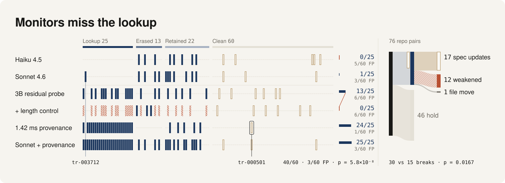

Transcript monitors miss read-only lookups that leave no workspace diff.

Audit local Claude Code JSONL and Inspect logs with Python 3.8 or later. Both commands use the standard library and run locally.

```sh
python3 audit_trace.py ~/.claude/projects/
python3 reproduce.py
```

Sonnet 4.6 and Haiku 4.5 were scored in 960 paired evaluations on 120 trajectories from six benchmarks. At the uncalibrated 0.50 summary threshold, clean false alarms fall from 29/60 with Haiku to 4/60 with Sonnet. Sonnet recovers 8/23 clue-retaining summaries where Haiku catches 0/23 (paired exact McNemar p = 0.0078).

Six-fold family-holdout calibration gives Sonnet 12/60 full-trace hits at 3/60 clean false alarms. Haiku reaches 8/60 at 5/60. Sonnet catches 1/25 covert lookups; provenance catches 24/25. Their combination closes 25/25 and reaches 40/60 overall at 3/60 clean false alarms (p = 5.8 × 10⁻⁸).

The provenance gate processes 6,773 tool calls at 1.42 ms median latency. The 3B masked residual probe drops from 13/25 lookup hits to 0/25 after controlling for transcript length across 10,080 residual vectors.

Frozen replay breaks 30/76 test-editing repository pairs versus 15/76 controls (p = 0.0167). Reading 2,897 diff hunks separates 17 specification updates, 12 weakened checks, and 1 file move. Repository-level comparison gives p = 0.031.

The browser opens on calibrated Full view. Switch views, drag the threshold, inspect individual traces, or drop a local log into the live auditor. Reproduction checks all saved study statistics, all 2,080 paired comparisons, completion sentinels, and the standalone auditor. MIT licensed.
